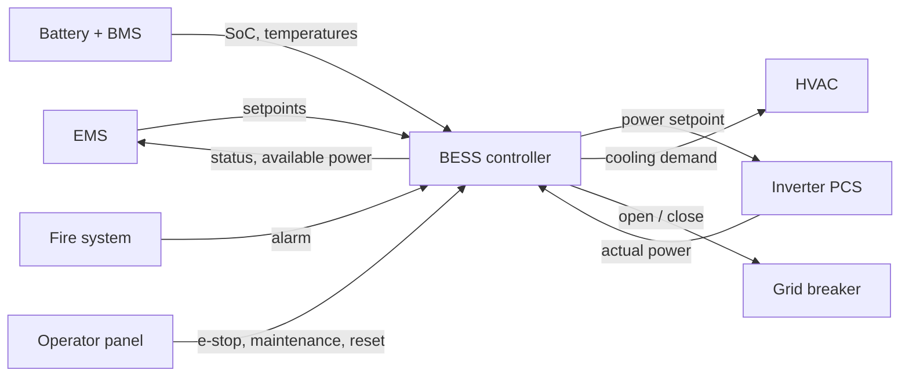

# Concept of Operations: BESS Controller

Status: draft for review. All figures are illustrative and must be backed by a cited public source before Phase 3.

## 1. Purpose

A standalone, grid-connected battery energy storage system (BESS) earns revenue through energy arbitrage: it charges when electricity prices are low and discharges when they are high. The BESS controller makes sure every charge and discharge command from the energy management system (EMS) is executed only within the safe operating limits of the battery and the grid connection.

## 2. System boundary

**Inside the boundary (the BESS controller):** command handling and power limiting, protection based on battery data, operating mode management, communication supervision, coordination of auxiliary systems, and status and alarm reporting.

**Outside the boundary (the controller only exchanges signals with these):**

- EMS: sends power setpoints, receives status and available power
- Battery racks and battery management system (BMS): provide cell temperatures, voltages and state of charge (SoC)
- Inverter (PCS): receives power setpoints, reports actual power
- HVAC unit: receives cooling demand
- Fire detection and suppression system: raises fire alarms
- Grid connection breaker: receives open and close commands
- Local operator panel: maintenance switch, emergency stop, alarm reset

## 3. Stakeholders and concerns

| ID | Stakeholder | Concern |
|----|-------------|---------|
| SC-01 | Asset owner | The unit delivers the power the EMS has sold, so trades are fulfilled. |
| SC-02 | Asset owner | The EMS always knows how much power and energy is really available, so it never sells what the battery cannot deliver. |
| SC-03 | Asset owner | The battery lasts its planned lifetime. |
| SC-04 | Battery supplier | Cells are operated within the warranty limits for SoC, temperature and charge rate. |
| SC-05 | Grid operator | Power at the connection point never exceeds the agreed connection capacity. |
| SC-06 | Grid operator | The unit behaves predictably when it loses contact with the EMS. |
| SC-07 | Fire and safety authority | A fire alarm leads to immediate de-energisation and isolation from the grid. |
| SC-08 | Fire and safety authority | Cells never reach temperatures where thermal runaway becomes likely. |
| SC-09 | Fire and safety authority | Any person on site can stop all power flow immediately. |
| SC-10 | Maintenance technician | No power flows while work is being done on the unit. |
| SC-11 | Maintenance technician | Alarms and faults are reported clearly enough to diagnose the cause. |

## 4. Operating modes

| Mode | What the controller does | Entered when | Left when |
|------|--------------------------|--------------|-----------|
| Standby | No power flow. Monitors the battery and reports status. Ready to start. | Start-up; EMS stop command; EMS communication lost. | EMS start command with all checks passed → Normal. Maintenance switch on → Maintenance. |
| Normal | Executes EMS setpoints, limited by SoC, temperature and connection capacity. | From Standby on EMS start command. | EMS stop command → ramp to zero, then Standby. EMS communication lost → power to zero immediately, then Standby. Fire alarm, e-stop or critical fault → Emergency. |
| Maintenance | No power flow. Grid breaker open. HVAC off. Monitoring continues. | Maintenance switch turned on while in Standby. | Maintenance switch turned off → Standby. |
| Emergency | Power set to zero, grid breaker opened, alarm latched and reported. | Fire alarm, emergency stop or critical fault, from any mode. | Only after the cause is cleared and a technician resets it on site → Standby. |

## 5. Assumptions and constraints

| Item | Assumed value | Source |
|------|---------------|--------|
| Rated power | 1 MW | [SOURCE NEEDED] |
| Energy capacity | 2 MWh | [SOURCE NEEDED] |
| Cell chemistry | Lithium iron phosphate (LFP) | [SOURCE NEEDED] |
| SoC operating window | 10 % to 90 % | [SOURCE NEEDED] |
| Maximum cell temperature for charging | 55 °C | [SOURCE NEEDED] |
| Grid connection capacity | 1 MW | [SOURCE NEEDED] |
| EMS interface | Modbus TCP | [SOURCE NEEDED] |
| EMS communication timeout | 5 s | [SOURCE NEEDED] |

Applicable standards to check before Phase 3: IEC 62933 (electrical energy storage systems) and VDE-AR-N 4110 (German medium-voltage grid connection rules).

## 6. Operating decisions

| ID | Question | Decision |
|----|----------|----------|
| OD-01 | Behaviour as SoC approaches its limits | Reduce power gradually towards the limit rather than stopping sharply at it. |
| OD-02 | Behaviour when EMS communication is lost | Set power to zero immediately. Do not hold the last setpoint. |
| OD-03 | HVAC in Maintenance mode | HVAC is switched off. |
| OD-04 | What sends the system to Emergency, and what only reduces power | Emergency: fire alarm. Power reduction only: SoC below 10 % or above 90 %. |